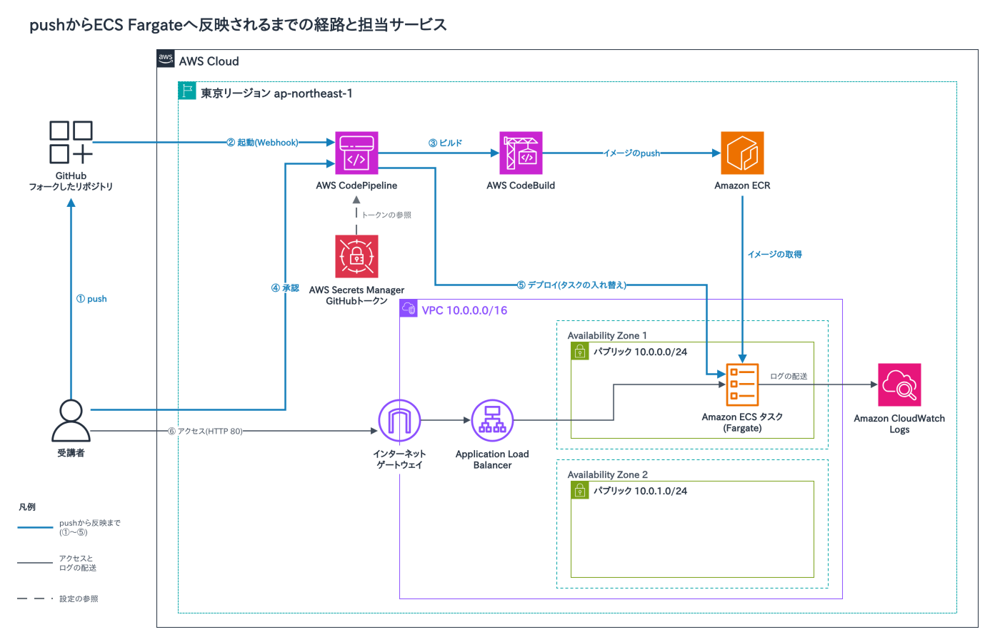

# ECS Fargate CI/CD ハンズオン

受講者が自分のAWSアカウントに、ECS FargateへのCI/CDパイプラインをAWS CDKで作るハンズオンの手順書です。GitHubのmainブランチへpushするとCodePipelineが動き、アプリのイメージのビルドと受講者の承認を経てECS Fargateへデプロイします。リージョンは東京(ap-northeast-1)を使います。

## 前提

- AWSアカウントと、マネジメントコンソールにサインインできるIAMユーザーかルートユーザー
  - IAMユーザーには`AdministratorAccess`と`SignInLocalDevelopmentAccess`のポリシーを付ける。`SignInLocalDevelopmentAccess`は`aws login`に要る
  - IAM Identity Center(AWS SSO)を使う人は、手順3の`aws sso login`で進める
- GitHubアカウント
- Node.js 18以上
- AWS CLI 2.32.0以上(`aws --version`で確かめる。`aws login`は2.32.0から使える)
- Git

## 構成



1. 受講者がGitHubのmainブランチへpushする
2. GitHubのWebhookでCodePipelineが起動し、sourceステージがソースを取り出す
3. buildステージでCodeBuildがDockerイメージをビルドし、ECRへpushする
4. approveステージで受講者が承認する
5. deploy-to-ecsステージがECSのタスクを新しいイメージで入れ替える。タスクはECRからイメージを取得する
6. 受講者はインターネットゲートウェイとApplication Load Balancerを経由してアプリを開く

図の元データは[docs/architecture.drawio](docs/architecture.drawio)。

## 手順

### 1. フォークする

GitHubで[mamezou/ecs-cicd-cdk](https://github.com/mamezou/ecs-cicd-cdk)を開き、右上の[Fork]から自分のアカウントにフォークする。リポジトリの名前は`ecs-cicd-cdk`のままにする。自分のアカウントに`ecs-cicd-cdk`が表示されたら完了。

### 2. クローンする

フォークしたリポジトリをクローンする。`<your-github-username>`は自分のGitHubのユーザー名に置き換える。

```bash
git clone https://github.com/<your-github-username>/ecs-cicd-cdk.git
cd ecs-cicd-cdk
```

以降のコマンドは、すべてこの`ecs-cicd-cdk`ディレクトリで実行する。

### 3. AWSにログインする

`aws login`でログインする。ブラウザが開くので、コンソールと同じIAMユーザーかルートユーザーでサインインする。リージョンを聞かれたら`ap-northeast-1`を入力する。

```bash
aws login --profile ecs-handson
```

AWS SSOを使う人は、`aws login`の代わりに`aws sso login --profile <your-sso-profile>`でログインし、次のコマンドの`--profile ecs-handson`を`--profile <your-sso-profile>`に置き換える。SSOのプロファイルの作り方は[AWS SSOの設定手順](docs/AWS_SSO_SETUP.md)にある。

このリポジトリのCDK CLI(2.110.1)は、`aws login`の認証情報を直接読めない。AWS CLIから認証情報を受け取るプロファイル`ecs-handson-cdk`を作り、以降はこのプロファイルを使う。

```bash
aws configure set credential_process "aws configure export-credentials --profile ecs-handson --format process" --profile ecs-handson-cdk
aws configure set region ap-northeast-1 --profile ecs-handson-cdk
export AWS_PROFILE=ecs-handson-cdk
export AWS_REGION=ap-northeast-1
aws sts get-caller-identity
```

`aws sts get-caller-identity`の結果に自分のアカウントIDが出たら完了。ターミナルを開き直したときは、2つの`export`をもう一度実行する。

### 4. GitHubトークンを作ってSecrets Managerに保存する

GitHubの[Settings] → [Developer settings] → [Personal access tokens] → [Tokens (classic)] → [Generate new token (classic)]で、スコープ`repo`と`admin:repo_hook`を付けたトークンを作る。トークンは作成した画面でしか表示されないので、その場でコピーする。画面ごとの操作は[GitHubの設定手順](docs/GITHUB_SETUP.md)にある。

作ったトークンをSecrets Managerに保存する。`<YOUR-GITHUB-TOKEN>`は作ったトークンに置き換える。

```bash
aws secretsmanager create-secret \
  --name /ecs-cicd-cdk/github/personal_access_token \
  --secret-string "<YOUR-GITHUB-TOKEN>"
```

次のコマンドでシークレットの名前が出たら完了。

```bash
aws secretsmanager describe-secret --secret-id /ecs-cicd-cdk/github/personal_access_token --query Name
```

### 5. CDKでデプロイする

`<your-github-username>`は手順2と同じく自分のGitHubのユーザー名に置き換える。

```bash
npm install
npm run build
npx cdk bootstrap   # このアカウントとリージョンで初めてCDKを使うときだけ
npx cdk deploy \
  --parameters githubUserName=<your-github-username> \
  --parameters githubRespository=ecs-cicd-cdk \
  --parameters githubPersonalTokenSecretName=/ecs-cicd-cdk/github/personal_access_token
```

- 3つのパラメータは省かない。省くとスタックの既定値が使われ、フォークしたリポジトリや手順4のシークレットと合わなくなる。
- `githubRespository`にはフォークしたリポジトリの名前を渡す。パラメータ名はスタックで定義した綴りなので、`githubRepository`に直さない。
- デプロイの途中で、作られるIAMロールとセキュリティグループの一覧が出て、`Do you wish to deploy these changes (y/n)?`と聞かれる。`y`を入力する。
- デプロイは5分ほどかかる。

### 6. アプリを開いて承認する

デプロイが終わると、次のような出力が出る。

```
Outputs:
EcsCicdCdkStack.loadbalancerdns = EcsCic-ecsse-xxxxxxxxxxxx-xxxxxxxxx.ap-northeast-1.elb.amazonaws.com
```

ブラウザで`http://<loadbalancerdnsの値>`を開くと、初期デプロイ用のnginxの画面が出る。

パイプラインは作成と同時に1回動き、デプロイが終わってから3分ほどでapproveステージの承認待ちになる。東京リージョンのCodePipelineのコンソールでパイプラインを開き、approveステージの[レビュー]から承認する。承認から4分ほどでdeploy-to-ecsステージが終わり、ブラウザの画面がFastAPIのアプリに置き換わる。

## CI/CDを試す

1. `docker-app/templates/hello.html`の`<h1>`にある`ECS CI/CD Demo`を、自分の名前などに書き換え、mainにpushする。

   ```bash
   git add docker-app/templates/hello.html
   git commit -m "Update app title"
   git push origin main
   ```

2. CodePipelineのコンソールで進み具合を見る。CodePipelineはsource → build → approve → deploy-to-ecsの順にステージを実行する。
3. approveステージを、手順6と同じ操作で承認する。
4. deploy-to-ecsステージが終わったら、ブラウザでアプリを開き、見出しが書き換わっていることを確かめる。

## 削除

起動している間はApplication Load BalancerとFargateの料金がかかるので、ハンズオンが終わったら削除する。

ECRのリポジトリ、CodePipelineの成果物を置くS3バケット、コンテナのログを置くCloudWatch Logsのロググループは、`npx cdk destroy`では削除されずに残る。スタックを削除する前に、3つの名前を控えておく。

```bash
ECR_REPO=$(aws cloudformation describe-stack-resources --stack-name EcsCicdCdkStack \
  --query "StackResources[?ResourceType=='AWS::ECR::Repository'].PhysicalResourceId" --output text)
BUCKET=$(aws cloudformation describe-stack-resources --stack-name EcsCicdCdkStack \
  --query "StackResources[?ResourceType=='AWS::S3::Bucket'].PhysicalResourceId" --output text)
LOG_GROUP=$(aws cloudformation describe-stack-resources --stack-name EcsCicdCdkStack \
  --query "StackResources[?ResourceType=='AWS::Logs::LogGroup'].PhysicalResourceId" --output text)
echo "$ECR_REPO $BUCKET $LOG_GROUP"
```

スタックを削除する。確認を求められたら`y`を入力する。削除は10分ほどかかる。

```bash
npx cdk destroy
```

残った3つを削除する。S3バケットは中のファイルごと削除する。

```bash
aws ecr delete-repository --repository-name "$ECR_REPO" --force
aws s3 rb "s3://$BUCKET" --force
aws logs delete-log-group --log-group-name "$LOG_GROUP"
```

手順4で保存したシークレットを削除する。

```bash
aws secretsmanager delete-secret \
  --secret-id /ecs-cicd-cdk/github/personal_access_token \
  --force-delete-without-recovery
```

最後に、GitHubの[Settings] → [Developer settings] → [Personal access tokens] → [Tokens (classic)]で、手順4で作ったトークンを削除する。

## うまくいかないとき

- `npx cdk deploy`が失敗したときは、エラーの内容を見る。スタックの状態は次のコマンドで見る。`ROLLBACK_COMPLETE`のときは`npx cdk destroy`で削除してから、原因を直してデプロイし直す。

  ```bash
  aws cloudformation describe-stacks --stack-name EcsCicdCdkStack --query "Stacks[0].StackStatus"
  ```

- パイプラインのsourceステージが失敗したときは、手順5の`githubUserName`と`githubRespository`の値と、手順4のトークンのスコープを確かめる。
- パイプラインのbuildステージが失敗したときは、CodeBuildのコンソールでプロジェクト`EcsCicdCdkStack`のビルド履歴を開き、ログを見る。
- ECSのタスクが起動しないときは、ECSのコンソールでタスクの詳細を開いて停止した理由を見て、CloudWatch Logsでコンテナのログを見る。
- pushしてもパイプラインが動かないときは、フォークしたリポジトリの[Settings] → [Webhooks]を開き、URLが`https://ap-northeast-1.webhooks.aws/`で始まるWebhookがあるかを見る。このWebhookがCodePipelineを動かす。なければ、手順4のトークンのスコープに`admin:repo_hook`があるかを確かめる。

## 詳しい資料

| 資料 | 内容 |
|---|---|
| [docs/GITHUB_SETUP.md](docs/GITHUB_SETUP.md) | GitHubトークンの作成から削除まで |
| [docs/AWS_SSO_SETUP.md](docs/AWS_SSO_SETUP.md) | AWS SSOのプロファイルの作り方 |
